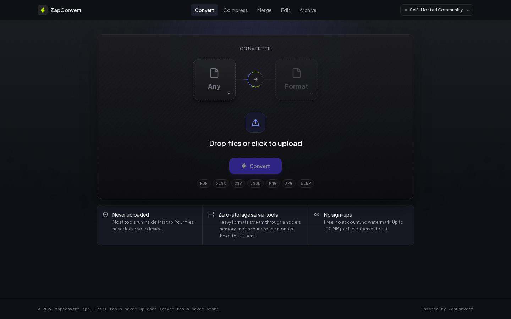
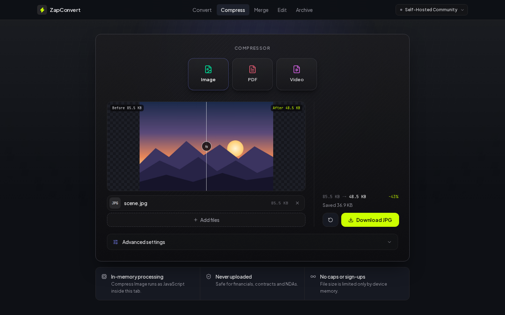
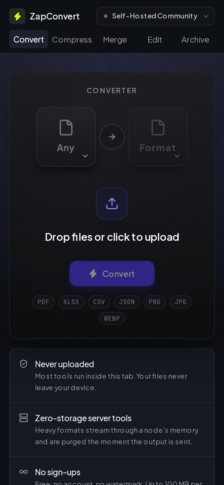

# ZapConvert (self-hosted)

Private file converter for your home server. Convert, compress, merge, split and protect PDFs,
Office documents, images, spreadsheets, audio and video from any browser on your network.



- **52 tools.** 38 run entirely in the browser (pdf-lib, PDF.js, Tesseract and qpdf compiled to
  WebAssembly), so the file never leaves the device, not even to your own server.
- **The other 14** (Office to PDF, PDF to Word and Excel, audio and video) go to two companion
  containers: [Gotenberg](https://gotenberg.dev) and a small ffmpeg / PyMuPDF worker. They sit on an
  internal Docker network with no published ports and work in RAM (tmpfs). Nothing is written to disk.
- **No ads, no analytics, no accounts.** The self-hosted image never loads third-party scripts.
- **Works offline.** Once the images are pulled, the interface requests nothing from outside your
  network.
- **Batch mode.** Drop several files on a tool and download the results one by one or as a ZIP.
- **amd64 and arm64** images on GitHub Container Registry.

| Before / after preview | Mobile |
| --- | --- |
|  |  |

Hosted version, with ads: [zapconvert.app](https://zapconvert.app)

## Install

### Docker Compose (Portainer, Dockge, Cosmos)

```sh
curl -fsSL https://zapconvert.app/docker-compose.yml -o docker-compose.yml
docker compose up -d
# open http://<your-server>:3000
```

The same file is [`docker-compose.yml`](docker-compose.yml) in this repository; paste it into any
stack manager as-is.

### Unraid

Search **ZapConvert** in Community Applications. Install `zapconvert-gotenberg` and
`zapconvert-media-worker` first, all three on one custom network:

```sh
docker network create zapconvert
```

Templates: [zapconvert/unraid-templates](https://github.com/zapconvert/unraid-templates).

### TrueNAS SCALE 24.10+

Apps > Discover Apps > Custom App > **Install via YAML**, then paste
[`templates/truenas/zapconvert.yaml`](templates/truenas/zapconvert.yaml). The web interface is on
port 30380.

### CasaOS / ZimaOS

App Store > Custom Install > Import, then paste
[`templates/casaos/docker-compose.yml`](templates/casaos/docker-compose.yml). The web interface is on
port 3380.

## Settings

Set these in the shell environment or a `.env` file next to `docker-compose.yml`. All are optional.

| Variable | Default | Meaning |
| --- | --- | --- |
| `WEB_PORT` | `3000` | Host port for the web interface |
| `ZAPCONVERT_VERSION` | `latest` | Image tag, for example `1.0.0` |
| `LICENSE_KEY` | blank | Lifetime Pass key; unlocks Self-Hosted Pro for every user |
| `MEDIA_WORKER_TOKEN` | blank | Shared secret between web and media worker (`openssl rand -hex 32`) |
| `CONVERT_MAX_UPLOAD_MB` | `100` | Per-file limit for server conversions on Community |
| `PRO_MAX_UPLOAD_MB` | `1024` | Per-file limit for server conversions on Pro |
| `MEDIA_MAX_JOBS` | `2` | Media conversions run at the same time |
| `MEDIA_SCRATCH_SIZE` | `2048m` | RAM scratch space for the media worker |
| `GOTENBERG_SCRATCH_SIZE` | `1024m` | RAM scratch space for Gotenberg |

Scratch space is RAM, so leave headroom for large videos.

## Editions

| | Community (free) | Self-Hosted Pro |
| --- | --- | --- |
| Every tool | Yes | Yes |
| Browser tools | Unlimited | Unlimited |
| Server conversions | 100 MB per file | 1 GB per file |
| Footer credit | "Powered by ZapConvert" | Hidden |

Pro is a one-off [Lifetime Pass](https://zapconvert.app/remove-ads). Keys are checked offline; the
instance never phones home.

## Updating

```sh
docker compose pull && docker compose up -d
```

## Support

Bugs and feature requests: [GitHub issues](https://github.com/zapconvert/zapconvert/issues).
Purchases and keys: support@zapconvert.app.

## Source and licences

The media worker is AGPL-3.0; its full source is in [`media-worker/`](media-worker) and every
instance serves the exact running version at `/source/zapconvert-media-worker.zip`. The web
application is proprietary and distributed as a free container image. Gotenberg is MIT-licensed
and pulled unmodified from Docker Hub.
